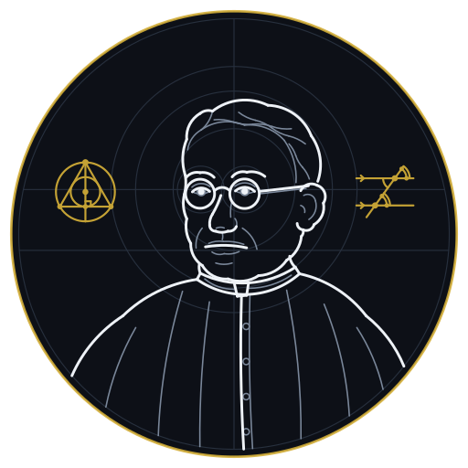

:site_title: Peter Hoenen, S.J.

.. _hoenen-home:

.. container:: author-overline

   semantic digital archive • the works of

==================
Peter Hoenen, S.J.
==================

:person:`Fr. Peter Hoenen, S.J. <hoenen>` (1880–1961)—trained in theoretical physics under H. A. Lorentz before holding the chair of natural philosophy at Rome's Pontifical Gregorian University—confronted the modern crisis of formalism and non-Euclidean axiomatics by returning to geometry's origin in *intuitive formal abstraction*. This synchronized Latin–English edition presents his 1954 Gregorian treatise *De Noetica Geometriae* complete with its first English translation, chapter summaries, and cross-corpus scholastic apparatus.

Books in This Collection
------------------------

.. container:: home-book-hero no-thumb

   .. container:: home-book-body

      .. rubric:: Primary Edition · 1954 (Analecta Gregoriana LXIII) · 7 Chapters & Appendix · 4 Tracks

      **The Noetics of Geometry (De Noetica Geometriae: Origine Theoriae Cognitionis)** — Transcribed from **299 archival folio scans** of the 1954 Rome edition, uniting the complete Latin text, the first English translation, chapter summaries, and critical translation notes on necessity, exactitude, Hilbertian axiomatics, and extension as intelligible matter.

      .. container:: home-actions

         * :doc:`Open De Noetica Geometriae → <de_noetica_geometriae/index>`
         * :doc:`Read the Preface → <de_noetica_geometriae/preface/preface-en>`
         * :doc:`Chapter I: Origin & Problematics → <de_noetica_geometriae/caput-1/caput-1-en>`
         * :doc:`Chapter V: On Axiomatics → <de_noetica_geometriae/caput-5/caput-5-en>`

Key Features
------------

.. container:: home-feature-grid

   .. container:: home-feature-card

      **Four-Track Bilingual Codex**

      Every chapter pairs the verbatim 1954 Gregorian Latin text with an accurate English translation, scholastic summary, and philological-mathematical notes.

   .. container:: home-feature-card

      **299 Folio-Linked Primary Scans**

      Every section and margin links monotonically via ``:folio:`` badges to the scanned 1954 *Analecta Gregoriana* printing, documented in the :doc:`Scan Inventory <de_noetica_geometriae/scan-inventory>`.

   .. container:: home-feature-card

      **Scholastic & Modern Concordance**

      Trace Hoenen's dialogue with Aristotle, Aquinas, Euclid, Descartes, Kant, Poincaré, Hilbert, and Russell across **412 cited references**, **83 biographical profiles**, and **99 glossary terms**.

Reference & Project
-------------------

.. container:: home-columns

   .. container:: home-col

      .. rubric:: Scholarly Apparatus

      * :doc:`People (83 Profiles) <de_noetica_geometriae/people/index>` — Classical philosophers, scholastics, and modern geometers
      * :doc:`Bibliography (412 Citations) <de_noetica_geometriae/bibliography>` — Chronological and alphabetical register of sources
      * :doc:`Technical Glossary (99 Terms) <de_noetica_geometriae/glossary>` — Latin and Greek lexicon of noetic geometry

   .. container:: home-col

      .. rubric:: About This Project

      * :doc:`About <about/index>` — Scope, Gregorian University history, and Thomistic-modern synthesis
      * :doc:`Using This Edition <usage/index>` & :doc:`Transcription Chronicle <de_noetica_geometriae/agent-chronicle>` — Navigation guide and editorial notes
      * :doc:`Log <log/index>` & :doc:`Modules <modules/index>` — Development notes and Python codex utilities

.. toctree::
   :maxdepth: 2
   :hidden:

   de_noetica_geometriae/index
   de_noetica_geometriae/people/index
   de_noetica_geometriae/bibliography
   about/index
   usage/index
   log/index
   modules/index
